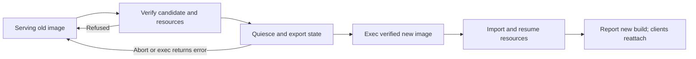

# Daemon hotreload investigation

This investigation includes isolated executable-replacement experiments and
terminal-state export APIs. Production hotreload commands and activation remain
unimplemented. It accompanies [Proposal 0018](proposals/0018-daemon-hotreload.md).
No production daemon was restarted or replaced during the investigation.

## Agreed behavior

The user allows a brief automatic reconnect between clients and the daemon.
SSH transports, VPN tunnels, existing TCP forwarding streams, PTYs, and shell
processes must remain alive. An old daemon retained as a resource worker does
not satisfy hotreload. Fresh Touch ID on the next protected credential use is
allowed after replacement; hotreload itself must not request credentials.
The user accepts the same daemon PID when the entire old program image is replaced.

The preferred Unix investigation is `exec` with complete runtime export/import.
Exec retains PID and child relationships but replaces the executable image,
threads, and userspace state. It preserves only descriptors not marked
close-on-exec. This does not create a new kernel process/PID. These properties
are documented by [Apple execve](https://developer.apple.com/library/archive/documentation/System/Conceptual/ManPages_iPhoneOS/man2/execve.2.html)
and [Linux execve](https://www.man7.org/linux/man-pages/man2/execve.2.html).

## Current implementation evidence

| Resource | Current owner or behavior | Required preservation |
| --- | --- | --- |
| Private SSH transport | External OpenSSH master; stable target-derived mux path | Same master, mux socket, endpoint policy, and connection correlation |
| Shared SSH master | External master plus optional ctld-held anchor pipe | Preserve anchor FD and lifetime semantics |
| VPN tunnel and SOCKS sessions | Shared Docker/Podman container with renewed interest | Same immutable container ID and uninterrupted acknowledged heartbeat interest |
| Private-master forwards | OpenSSH listeners, metadata tracked by ctld | Adopt definitions and listeners without cancel/re-add |
| Shared-master forwards | Ctld TCP listeners, SSH children/pipes, async byte-copy tasks | Preserve descriptors, buffered bytes, offsets, EOF/half-close and child state |
| Proxy routes | Separate long-lived processes running ctld code | Coordinated helper exec; unsupported old helpers cause refusal |
| Native authorization | Ctld-owned Objective-C LAContext | Do not pretend it survived; require fresh authorization for later protected reads |
| Terminal work | Ctmuxd-owned PTY/ConPTY, shell child, reader and waiter | Original PTY, child identity and correct exit observation |
| Terminal runtime | In-memory AVT state, history/journal, registry, leases and timers | Complete versioned export/import, not a displayed-screen checkpoint |
| Client IPC/attachments | Daemon request and attachment tasks | Automatic reconnection with safe transport supersession |

Ctld's [shutdown path](../ctl/daemon/src/lib.rs) aborts request tasks, cancels
forwards, shuts down VPN renewal and shared relays, and drops anchors/listeners.
The existing [ctld lifecycle](../ctl/daemon/src/lifecycle.rs) transfers a restart
request to this destructive owner loop. Private master startup uses
`ssh -f -M -N` and `ControlPersist=300`; [shared anchors](../ctl/daemon/src/ssh_config_master.rs)
hold a remote `cat` channel open. Closing an anchor changes lifetime policy even
when other channels temporarily keep the master alive.

VPN [renewal](../ctl/daemon/src/vpn_container.rs) runs every two seconds; current
[heartbeat](../ctl/daemon/assets/vpn/heartbeat.sh) expiry defaults to 15 seconds.
The [watchdog](../ctl/daemon/assets/vpn/watchdog.sh) terminates tunnel/SOCKS when
all interests expire. Passive listing is not adoption and does not renew interest.
Import must resume the same container, without settings/secret replay or an
engine restart. A proven cutover deadline or temporary renewal by the verified
new-code updater is needed; an assumed 15-second startup margin is insufficient.

Ctmuxd's [cooperative restart](../ctmux/daemon/src/server.rs) calls `kill()` on
every terminal and clears managed-task associations. Its [session runtime](../ctmux/daemon/src/session.rs)
directly owns PTY masters, writers, child termination handles, reader/waiter
threads, and memory-only terminal/attachment state.

## Why descriptor handoff alone is insufficient

Descriptors preserve kernel resources, not Tokio futures or bytes already read
into userspace. [Shared-forward relays](../ctl/daemon/src/shared_forwarding.rs)
currently use opaque `tokio::io::copy` futures. Replace them with explicit,
checkpointable directional buffers, write offsets, and half-close state before
attempting reload with active streams.

The PTY reader can consume bytes into a thread-local buffer before appending them
to the terminal journal. It must acknowledge quiescence only after those bytes
are committed. A waiter can reap a child before publishing its exit status;
that transition must likewise be committed before export.

Current `portable-pty` Unix descriptors are close-on-exec, and its public API
does not reconstruct a master/child object from inherited descriptors. Its Unix
writer destructor injects newline and VEOF before closing. Running ordinary
cleanup after duplicating a master can therefore end the supposedly preserved
shell. The hotreload path needs an ownership-aware PTY adapter and must not run
that destructor on successful exec.

Passing FDs to a different PID does not transfer parenthood. A new daemon cannot
portably reap the predecessor's shell children with `waitpid`; retaining the old
reaper would violate the selected requirement. [Apple wait](https://developer.apple.com/library/archive/documentation/System/Conceptual/ManPages_iPhoneOS/man2/wait.2.html)
documents child ownership, and [Linux SCM_RIGHTS](https://kernel.googlesource.com/pub/scm/docs/man-pages/man-pages/+/cd95675fc3e38b6175ecd568cca4c4694d3db76d/man7/unix.7)
transfers references to open file descriptions, not process parenthood.

## Clean implementation boundaries

Exec is a suitable lifecycle primitive, but the current daemons are not ready
for clean runtime restoration. Ctmuxd's Terminal combines semantic VT/history/
attachment state, native PTY/child handles, and worker execution. Ctld similarly
mixes connection policy, external resource ownership and in-progress relay work.
Adding scattered snapshot hooks to these objects would make lifecycle changes
fragile. First establish explicit private boundaries inside each existing daemon:

| Boundary | Owns | Responsibility |
| --- | --- | --- |
| Semantic runtime state | Terminal parser/buffers, registries, histories, policies, logical identities and deadlines | Each component exports/imports its own complete, versioned state and validates it |
| Native resource adapter | PTYs, child identity, listeners, sockets, pipes, FIFOs and descriptor ownership | Quiesce at acknowledged boundaries, prepare inheritance and adopt resources exactly once |
| Reload coordinator and bootstrap | Candidate verification, admission gate, preparation generation and activation outcome | Orchestrate export/exec/restore before normal startup, without domain-specific mutation replay |

AVT owns its state format; the session manager owns its registry/attachment format;
relay actors own their buffer/half-close format. A top-level manifest composes
these exports and native descriptor roles. It does not serialize arbitrary Rust
memory, mutexes, futures, or public client DTOs. Keep native ownership operations
in an audited adapter rather than exposing raw descriptors to domain commands.

The coordinator uses a single admission/quiescence boundary. Creation, rename,
split and other ordinary operations should not each learn a second hotreload
execution path. New workers are rebuilt around imported semantic state; no old
thread or task implementation is retained.

Complete snapshots are substantial work even with this separation. Compatibility
tests must cover each component's future behavior, so a parser or lease change
cannot quietly make an older checkpoint incomplete. The first implementation
gate stays a small isolated PTY replacement proof; a passing proof establishes
the OS/adapter boundary, not complete daemon support.

## Complete checkpoint requirements

For ctld, preserve endpoint mappings and socket identities, correlations,
ownership policy, shared anchors, forwarding definitions and active relay
buffers, child identity, VPN descriptors/interests, and target pause/manual
disconnect/authentication-required state and generations. Quiesce resource-bearing
operations at an exportable boundary; finish or refuse protected credential reads,
credential mutations, per-attempt authentication work, and unsupported master/proxy
startup states. Neither interactive prompts nor noninteractive native operations
may be partially checkpointed or aborted as an export shortcut.

Native [AuthenticationContext](../ctl/keychain-client/src/native.rs) contains a
retained LAContext; its destructor invalidates it. Apple documents reuse without
another prompt when a [previously authenticated context](https://developer.apple.com/documentation/security/ksecuseauthenticationcontext)
is supplied.
Application scope IDs, timestamps, a preserved PID, and device-unlock reuse
duration do not reconstruct this object. After exec, invalidate the corresponding
approval records and rebuild watches. Preserve live connections, but let a later
protected read report authentication-required through the normal explicit flow.
Do not serialize plaintext credentials as a shortcut. Sleep/lock, credential
revision, trust/configuration changes and manual disconnect still apply.

For ctmuxd, export:

- Original root/session/view/terminal IDs, names, creation times, layout,
  geometry and revisions, automatic-name allocation, and task/run associations.
  Preserve SessionManagerInner's logical instance ID, which managed-task mutations
  pin, separately from the executable generation.
- Both complete AVT buffers and scrollback, wrapped rows, cell attributes and
  occupancy, active buffer, cursor/saved contexts, tabs, charsets, margins,
  modes, parser state and reflow/scrollback configuration.
- Partial UTF-8 input, input-mode/control parser fragments, alternate-screen
  observers, physical/logical history and generations, output journal/chunks,
  raw sequence offsets, and geometry checkpoints at their exact boundaries.
- Logical attachment identities/tokens/generations, input and layout leases,
  disconnection/expiry deadlines, lifecycle/exit status and child birth identity.
- Shell state/revisions, reporter FIFO descriptors/path and notification state.

AVT [dump_buffer](../ctmux/avt/src/terminal.rs) iterates the visible buffer view,
not complete scrollback; inactive alternate-buffer content is not fully dumped.
The dedicated [AVT runtime checkpoint](../ctmux/avt/README.md#runtime-checkpoints)
now preserves both buffers, history and parser state without rendering controls.
It is one component of the required daemon checkpoint. Partial UTF-8 input stays
with the caller's decoder, and the daemon's separate physical/logical history,
journal, registry, attachments and shell reporter state still need exports.

Rebuild mutexes, channels, notification caches and the Tokio runtime from semantic
state. Do not try to serialize their old task identities. Re-register inherited
handles with the new event loop and restore close-on-exec before launching children.
Bootstrap must also restore the intended signal mask/dispositions, including child
exit handling: exec resets caught handlers but can preserve ignored/blocked signals.

## Ownership and activation

Use a stable logical owner identity, separate executable generation, unique
reload ID, pinned verified executable/build, and explicit state-schema negotiation.
Status must identify the actual active build even when its PID is unchanged.
Preserve per-connection correlation IDs; a reload ID identifies the update
transaction and is not a new connection correlation.

The present [startup lock](../ctl/ipc/src/daemon_startup.rs) is released when
startup is ready, so it is not a daemon lifetime fence. Ctld's SocketGuard
unconditionally unlinks the pathname on drop. Introduce lifetime ownership and
generation/inode-aware endpoint cleanup before a reload path can safely coexist
with launchers and stale cleanup. Inherit the live listeners and lock; do not
unlink/rebind a live endpoint as a shortcut.

The staged operation should:

1. Observe the existing owner without starting one; verify replacement integrity,
   signing, named contracts, checkpoint compatibility and every active resource.
2. Establish a bounded preparation plan tied to owner/build/generation. Freeze
   mutations and park all readers/writers/waiters at acknowledged boundaries.
3. Export bounded state through private, nonpersistent descriptors and an explicit
   FD-role manifest. Tokens and relay buffers are sensitive even without passwords.
4. Establish safe VPN heartbeat coverage. Retain listeners, anchors, PTYs, pipes,
   resource sockets and lifetime lock through the exec boundary. No unrelated
   descriptor or secret belongs in the inheritance set.
5. Exec without ordinary shutdown, killing children, EOF injection, or socket/FIFO
   cleanup. Bootstrap the replacement before normal bind/setsid/new-registry paths.
6. Validate and import all resources, restore descriptor flags, start exactly one
   reader/writer/waiter per resource, resume renewal, then accept clients.
7. Verify actual new executable/build and reload ID. Client transports may reconnect;
   replay uses client-applied output cursors, never input or uncertain mutations.

Complete ctld activation must inventory old `--proxy-route` code images too.
Each helper needs the same buffered-stream safety and supported exec path.
The inventory must be authoritative and scoped to the selected logical broker
and endpoint, using private helper registration/control established at creation.
Current helpers have no such contract; process-name/path scans cannot prove
complete takeover, and untracked legacy active helpers make preparation unsupported.
Multi-process preparation must detect unsupported helpers before activation;
partial activation must report each resource's build/generation explicitly, not
be called successful hotreload or complete rollback. An already-replaced helper
cannot be atomically reverted by restoring only the broker.

Proposed Rust client operations are `inspect`, `prepare_hotreload`, consumed
`PreparedHotreload::activate`, and `inspect_hotreload(reload_id)`. Preparation
owns an expiring owner-pinned stream, like existing maintenance APIs. The daemon
CLI commands and ctl/desktop adapters call this library; no generic new daemon
or arbitrary remote command dispatcher is needed. Exact wire fields/versions
remain to be designed after the runtime proof.

## Failure boundaries

Before exec, candidate or export failures leave the old owner available. If exec
returns an error, restore flags and unpark existing tasks without recreating work.

After successful exec, the old userspace image no longer exists. An import failure
may deliberately exec back to the previous verified binary while all descriptors
and compatible rollback state are intact. This needs a minimal bootstrap that
cannot run destructive guards before validation. It is not arbitrary-crash
rollback: a fatal replacement crash can close the last PTY/socket owner and lose
live work. A checkpoint file cannot keep those resources alive. The selected
no-old-worker requirement rules out promising a retained owner's safety net.
Linux also documents rare exec failures after the old image has been torn down;
the kernel can terminate the process before replacement bootstrap. Those are
not returned exec errors and belong to the same unrecoverable boundary. See
[Linux execve notes](https://www.man7.org/linux/man-pages/man2/execve.2.html).

No timeout, unsupported state, lost acknowledgment or incompatible binary may
silently fall back to cold restart. Inspect uncertain results by reload ID and
active executable generation. Legacy current owners lack export/exec cooperation;
their first transition requires an explicitly chosen bootstrap restart or refusal.

## Platform boundary

macOS/Linux exec is the first feasibility target. New macOS code must satisfy
the normal [Keychain signing/access rules](https://developer.apple.com/documentation/technotes/tn3137-on-mac-keychains);
keeping the PID is not an entitlement bypass.

Windows remains unsupported for the selected full-replacement guarantee.
[DuplicateHandle](https://learn.microsoft.com/en-us/windows/win32/api/handleapi/nf-handleapi-duplicatehandle)
does not establish an HPCON transfer contract. Microsoft's implementation has
private [ConPTY packing machinery](https://github.com/microsoft/terminal/blob/main/src/winconpty/winconpty.cpp),
but that is not a public supported export/import API. [ClosePseudoConsole](https://learn.microsoft.com/en-us/windows/console/closepseudoconsole)
sends close events to attached applications. Passing pipes or copying opaque
representations is not evidence that full takeover is safe.

## Proof gates and implementation order

### Implemented isolated experiment

The [A/B examples](../ctmux/daemon/examples/README.md) and
[integration tests](../ctmux/daemon/tests/exec_hotreload.rs) implement the first
OS-boundary experiment. They create a private PTY and controlled shell, replace
two distinct executable images in place, export a consumed partial record, and
resume the original stream and shell. Actual executable fingerprints, shell
PID/birth identity/parent/TTY, shell-owned counter, stable synthetic IDs, exact
history and inherited-descriptor counts are verified. The updated image reaps
the original child with exit code 37.

The tests exercise two and six replacements, plus a returned exec error followed
by successful live-shell I/O and later replacement. The initial OS proof passed on
aarch64 macOS and in a fresh aarch64 Linux musl container, using Rust 1.99.0.
The Linux run used a cached Alpine image with networking disabled, offline
dependencies, read-only repository/registry mounts and temporary build output.
Clean default Cargo test selection also built the example executables correctly.
Complete daemon state and multithreaded quiescence remain future work.
No live ctld/ctmuxd was touched.

The experiment uses standard descriptors 0/1 as PTY carriers to stay within safe
Rust APIs. This is an isolated proof technique, not the production resource API.
Its argument checkpoint contains synthetic data only; production must use a
private bounded state transport and a typed inherited-resource manifest.

### Implemented emulator and observer export gate

AVT now owns opaque, serde-compatible `VtState` and standalone `ParserState`
checkpoints. Version 1 covers both buffers and scrollback, cell occupancy and
attributes, wrap links, active and saved cursor contexts, charsets, tabs,
terminal modes and margins, dirty lines, resize policy, deferred history cleanup,
and unfinished control parser state. Import validates the version and invariants
before constructing a mutable emulator. `StateLimits` bounds dimensions,
aggregate lines/cells, and scrollback capacity; callers must additionally bound
encoded input before deserialization, which can allocate first.

The [13 AVT state tests](../ctmux/avt/tests/runtime_state.rs) cover uninterrupted
processing compared with prefix → serialized export/import → suffix processing.
Coverage includes all parser states and split CSI/OSC/DCS controls,
both active and inactive buffers, saved state, mode-dependent behavior,
resize/reflow, and pending scrollback cleanup. Invalid imports and configurable
limits are checked separately from valid continuation.

[Ctmux-core observer exports](../ctmux/core/README.md#terminal-observer-checkpoints)
preserve input modes and alternate-screen tracking, including their own pending
control prefixes. `TerminalInputModesState` and `AlternateScreenState` each have
independent representation version 1. Ctmuxd uses the shared alternate-screen
observer without changing its client protocol.

The A/B proof composes these exports with the byte decoder's pending UTF-8 state
in private proof schema 2. Exec boundaries alternate between an unfinished CSI
parameter sequence and an incomplete UTF-8 character. An uninterrupted replay of
the consumed raw output provides a reference for imported emulator/observer state
and continued processing. This exercises state transfer through actual program
image replacement while the original shell remains alive; it does not export a
production session manager or replace multithreaded reader/waiter quiescence.

The composed proof passes on aarch64 macOS and Linux musl, including six image
replacements and returned-exec recovery. AVT/core tests, the daemon observer
regressions, strict workspace Clippy, and formatting checks also pass. The test
driver allows 60 seconds for a whole actor run to accommodate debug image hashing
and snapshots on virtualized Linux; individual actor I/O deadlines remain five
seconds. These tests remain isolated from production daemons and connections.

### Coverage required before production

Start with an isolated Unix PTY proof, not a production reload command:

1. Executable A owns one PTY and child with numbered output and nonce input.
2. Quiesce at a committed boundary and exec distinguishable executable B.
3. B adopts the same PTY/child, reports its own build with the same daemon PID,
   continues output/input, and reaps the original child with its actual exit code.
4. Repeat reload, test child exit around the boundary, failed exec and incompatible
   imports; verify no descriptor leaks, duplicate readers, respawn, or EOF injection.
5. Run the proof on both macOS and Linux before integrating a daemon command.

The inherited-FD/child adapter is a safety boundary. The workspace forbids unsafe
code; use an audited abstraction rather than weakening that rule globally.
Current portable-pty/std Child APIs do not provide the required reconstruction.

Next, extend component export/import to the daemon's physical/logical history,
output journal and sequences, session/view registry, attachment tokens and lease
deadlines, managed-task associations, and shell-reporter FIFO/parser state. Prove
committed reader/writer/waiter quiescence and native ownership adoption before
adding ctmuxd activation, lease supersession and client reattachment. Separately
prove checkpointable ctld forwarding and helper streams, VPN interest adoption,
unchanged master identity, credential policy and actual broker/helper image
replacement. Publish command
capabilities only after these proofs pass.

Final tests must cover continuous output, partial writes, partial UTF-8/CSI/OSC/DCS,
alternate-screen transitions, wrapped history, resize boundaries, multiple viewers,
lease contention, managed tasks, child exit, sleeping clients, stale generations,
concurrent reloads, mismatched descriptors/state, interrupted acknowledgments,
pre-exec abort, safe exec-back and repeated update. A screen that looks the same
or an installed new binary alone does not demonstrate hotreload.

Protocol changes: none. The emulator/observer representation versions and private
proof schema are independent of named client/daemon contracts; no production
persistence format is introduced. Proposed control additions and their current
contract baselines are recorded in Proposal 0018.
